# platform-kit architecture

How the framework turns a request into a configured, validated server, and how its reusable
middleware layer (Tomcat, Apache httpd, JBoss; standalone and HA) is built, tested and handed
over. Diagrams are [Mermaid](https://mermaid.js.org/) and render on GitHub.

> Status labels used below: **tested** (run end to end, see [Status](#11-status)), **written**
> (code complete, never run against the real target), **planned** (not built).

---

## 1. Design principles

| Principle | What it means in the code |
|---|---|
| **Logical request, physical profile** | A request says `sizing: medium`, never `Standard_D4s_v5`. Only the customer *profile* maps logical names to real ones. Switching customer = switching profile, not editing roles. |
| **Contracts between layers** | `request.v1` → `machine_spec.v1` → `machine_result.v1`. Each layer reads only the contract in front of it, so a provider change never ripples into OS or middleware roles. |
| **Pluggable drivers** | A capability (`compute`, later `dns`, `cmdb`, ...) has interchangeable drivers (`mock`, `existing`, `azure`, `vmware`, later `terraform`) behind one contract. |
| **Fail closed** | Unknown values, disallowed environments, unbound capabilities, missing fencing, unpinned downloads: the run stops before touching anything, with one precise message. |
| **Plan before apply** | Every playbook supports `--check --diff`; roles detect a brand-new host and say what they *would* do instead of failing. |
| **Idempotent by proof** | A second run must report `changed=0`; CI and the lab enforce it. |
| **Secrets never in data** | Requests, profiles, vars files and results hold references only. Secrets come from AAP credentials / Vault and are passed with `no_log` or on stdin. |
| **Thin layer is framework-free** | The middleware roles and thin playbooks run on their own with flat variables, so they can be copied into a customer's repo. |

---

## 2. Big picture

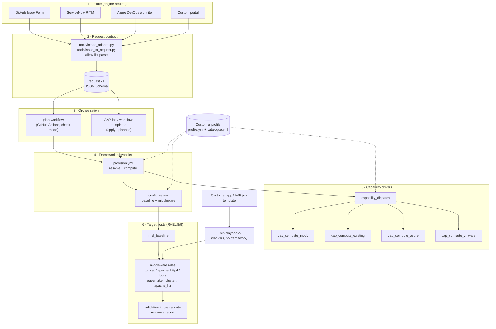

There are **two ways in**:

1. **Framework path** - a logical request flows through contracts, the profile and a compute driver, then the host is configured. Used when the platform owns the whole lifecycle.
2. **Thin path** - a caller (the customer's own AAP job template or app) runs one thin playbook with flat variables against VMs that already exist. Used to hand middleware automation to a customer whose platform already builds the VMs.

Both paths use the **same** OS and middleware roles.

---

## 3. Request intake and the plan workflow

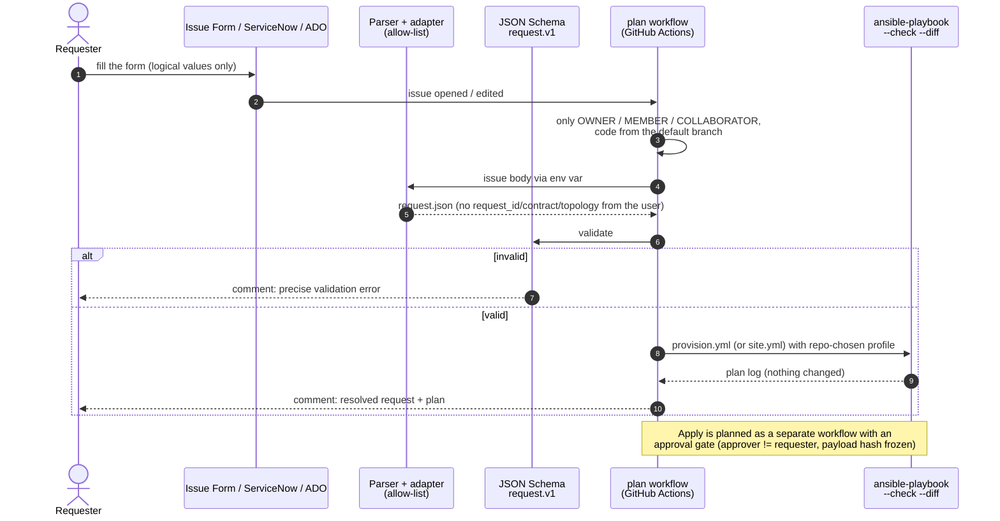

- Adapters only **extract** fields; `tools/intake/common.py` does the strict part (allow-list, value maps, schema). The source can never set `contract`, `request_id` or `topology`.
- Which profile and playbook are planned comes from **repo variables**, never from the issue.
- Status: parser and adapters **tested** (unit tests); the `plan` workflow is **written** (never executed on GitHub); apply is **planned**.

---

## 4. Contracts

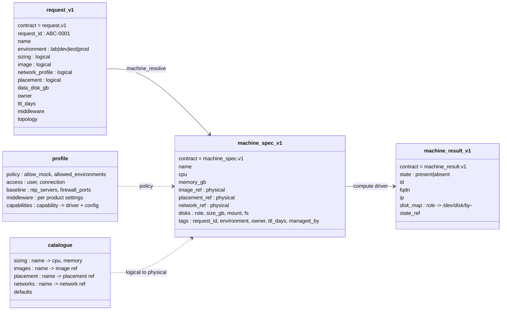

| Contract | Produced by | Consumed by | Enforced by |
|---|---|---|---|
| `request.v1` | intake adapters | `machine_resolve` | JSON Schema (`contracts/request.v1.schema.json`) |
| `machine_spec.v1` | `machine_resolve` | compute drivers | each driver's `meta/argument_specs.yml` |
| `machine_result.v1` | compute drivers | `configure.yml`, OS and middleware roles | `capability_dispatch` (`validate_argument_spec` on every driver output) |

`machine_result.v1` is the **only** thing downstream roles may read about a machine, so a VMware
VM and an Azure VM look identical to `rhel_baseline`. Disks are addressed by role through stable
`/dev/disk/by-*` paths, never `/dev/sdX`.

---

## 5. Provision: resolve and dispatch

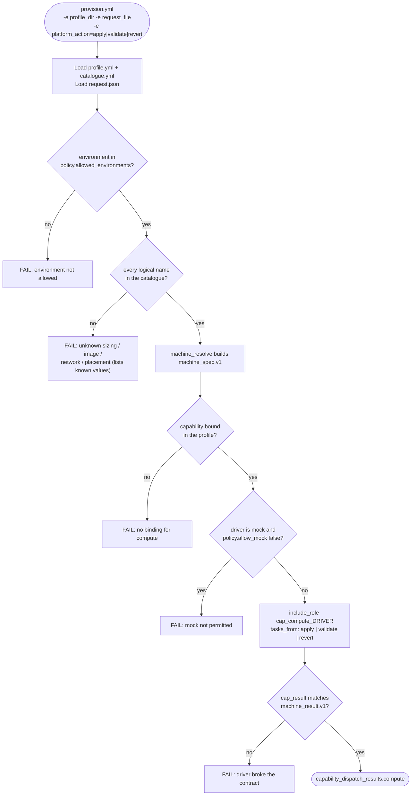

Every driver implements the same three entry points:

| Entry point | Meaning |
|---|---|
| `apply` | make the machine exist as specified (idempotent) |
| `validate` | read-only: does it exist and match? |
| `revert` | delete it - only if it carries this request's ownership tag/annotation |

| Driver | Engine | Status |
|---|---|---|
| `mock` | Ansible, local state file | **tested** (CI: apply, re-apply `changed=0`, validate, revert) |
| `existing` | Ansible, bring-your-own host | **written**, used for real-VM baseline tests |
| `azure` | `azure.azcollection` | **written** (logic tests only), private IP only, SSH key only |
| `vmware` | `community.vmware` | **written** (logic tests only), annotation ownership guard |
| `terraform` | `cloud.terraform` | **planned** - same contracts, so nothing downstream changes |

---

## 6. Configure: from machine result to configured host

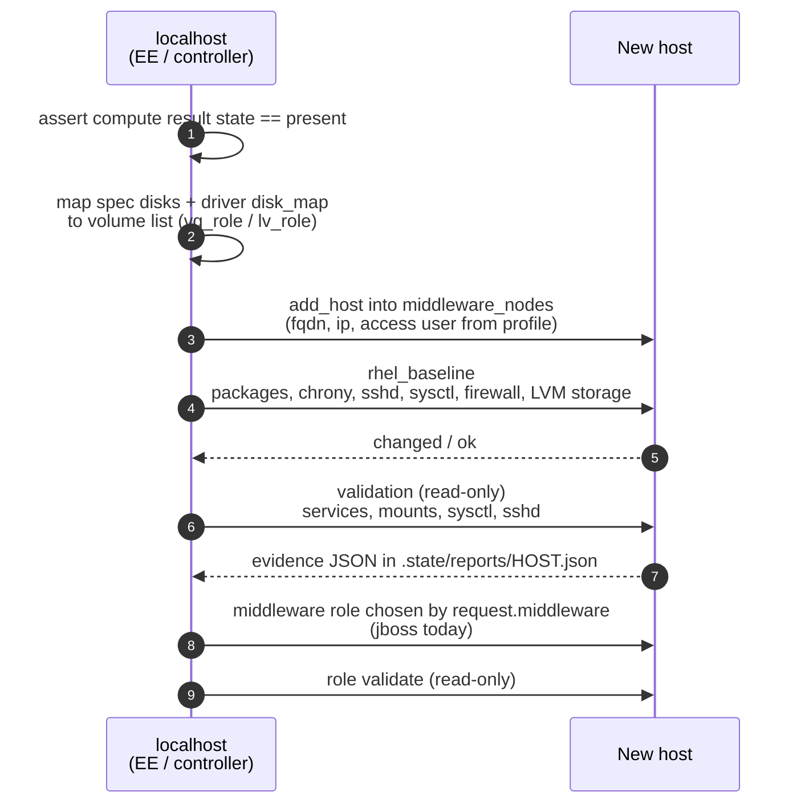

`site.yml` = `provision.yml` (apply) + `configure.yml`. Nothing in `configure.yml` knows which
provider built the host.

---

## 7. The thin layer

The thin layer is what gets copied to a customer. It has no profile, no request file and no
dispatcher: flat variables in, roles applied, read-only validation out.

### 7.1 Anatomy of a thin playbook

```mermaid
flowchart LR
    subgraph p1["Play 1 - localhost, tags: always"]
        V1["Check host patterns are plain"]
        V2["Check booleans are true/false"]
        V3["Check required values<br/>(NTP if baseline, VIP, password...)"]
        V4["Check explicit decisions<br/>(fencing, cluster ownership)"]
    end
    subgraph p2["Play 2+ - target hosts, become"]
        B["rhel_baseline<br/>(only if run_baseline)"]
        R["product role(s)<br/>main.yml"]
        OV["validation role<br/>(if run_os_validation)"]
        RV["role tasks_from: validate"]
    end
    IN(["-e @vars.yml<br/>-e @vault.yml"]) --> V1 --> V2 --> V3 --> V4 --> B --> R --> OV --> RV --> OUT(["PLAY RECAP<br/>second run: changed=0"])
```

Bad input stops the run in play 1, **before any host is touched**. Validation steps are skipped in
check mode (they need the real state).

### 7.2 Anatomy of a product role

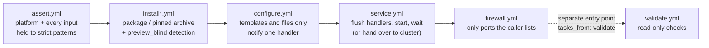

- `meta/argument_specs.yml` declares every input for `main` and `validate`.
- Variables are prefixed with the role name (ansible-lint production profile).
- **preview_blind**: in check mode on a host where the product is not installed yet, the role
  prints what it would install and skips the steps that need files on disk, instead of failing.

### 7.3 Role map

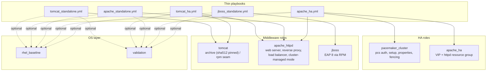

---

## 8. Middleware topologies

### 8.1 Tomcat standalone (`tomcat_standalone.yml`)

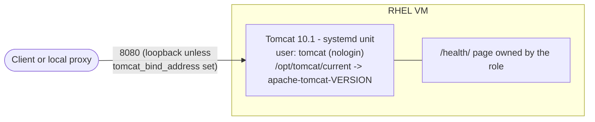

Secure defaults: shutdown port disabled, no AJP, default webapps removed, no error details, no
hot deploy, `NoNewPrivileges` / `ProtectSystem`. Upgrade = new version variables (new directory,
symlink flip); rollback = old variables.

### 8.2 Tomcat HA (`tomcat_ha.yml`)

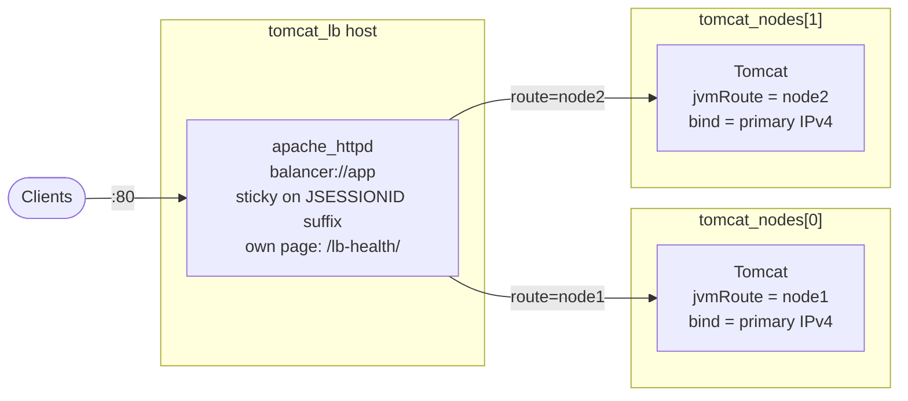

- Each node gets a unique `jvmRoute`; Tomcat appends it to the session id
  (`JSESSIONID=abc.node2`) and the balancer keeps that session on `node2`.
- A node that refuses connections is skipped and retried after `apache_httpd_proxy_retry` seconds.
- `run_load_balancer: false` when the platform has its own balancer (F5, NetScaler, cloud LB):
  point it at each node's bind address and `/health/`.
- Sessions are **not** replicated: users of a failed node log in again.

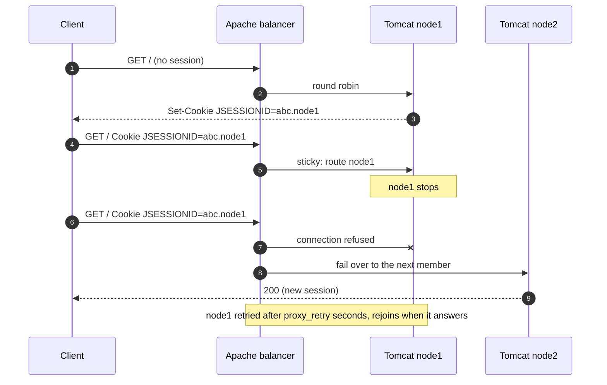

### 8.3 Apache standalone (`apache_standalone.yml`)

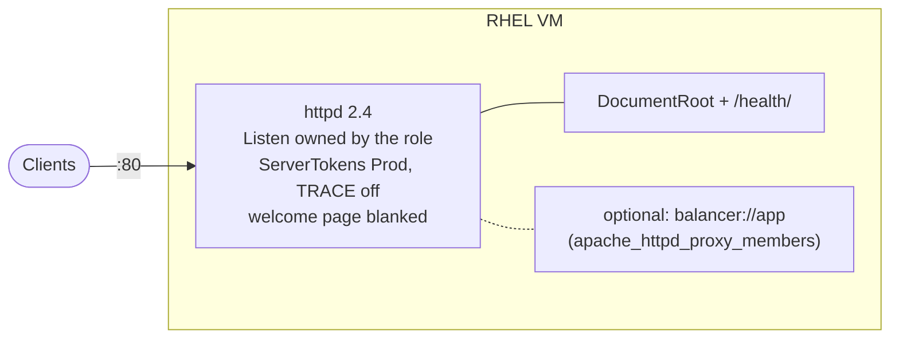

Every config change runs `httpd -t` **before** the reload handler, so a bad config fails the run
and the running server keeps its previous config.

### 8.4 Apache HA (`apache_ha.yml`)

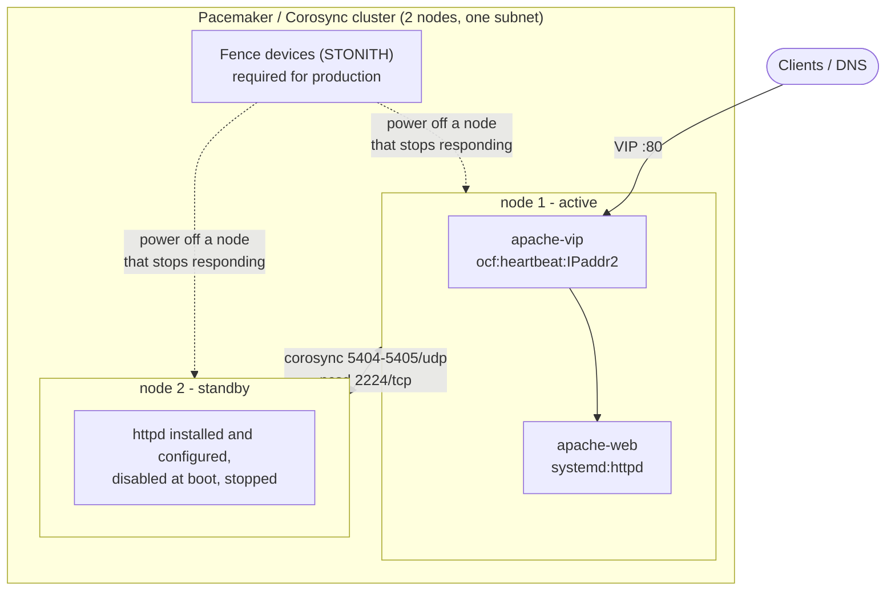

- `apache-group` = VIP first, then httpd; started together on one node, stopped in reverse.
- `resource-stickiness=100`: after a failover the group stays where it is when the failed node
  returns (no second outage from fail-back).
- httpd is installed and configured on **both** nodes (`apache_httpd_cluster_managed: true`) but
  never enabled at boot; only the cluster starts it. Config reloads go only to the node where
  it runs.

How the playbook builds it:

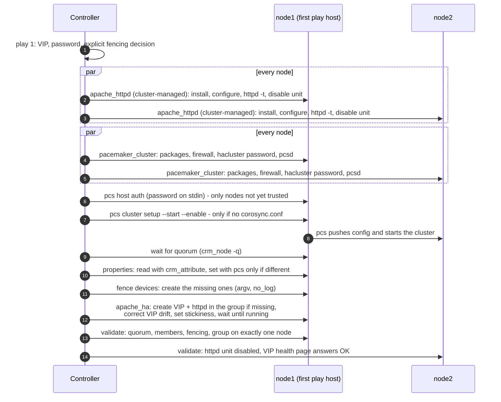

Failover:

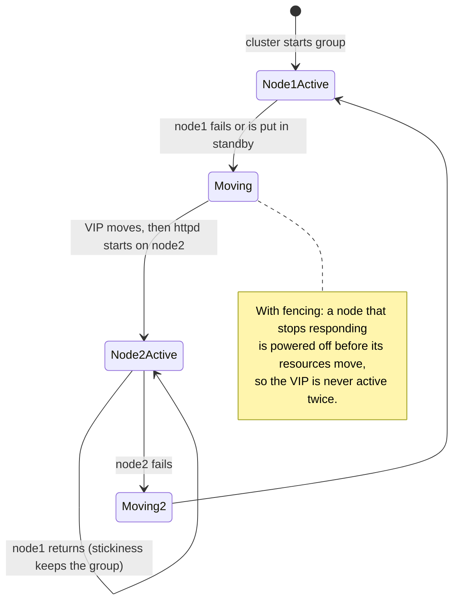

---

## 9. Testing and quality gates

### 9.1 CI (every push and pull request)

```mermaid
flowchart LR
    PR(["push / PR"]) --> C1["Contracts:<br/>sample requests conform"]
    C1 --> C2["Issue form in step<br/>with the profile"]
    C2 --> C3["Parser + adapter<br/>unit tests"]
    C3 --> C4["ansible-lint<br/>production profile"]
    C4 --> C5["syntax-check<br/>framework + thin playbooks"]
    C5 --> C6["Logic tests: templates,<br/>azure / vmware derivation,<br/>ss loopback parsing"]
    C6 --> C7["Thin export: no framework words,<br/>syntax-check, lint"]
    C7 --> C8["Mock lifecycle:<br/>apply, re-apply changed=0,<br/>validate, revert"]
    C8 --> OK(["green"])
```

CI never holds deployment credentials (`permissions: contents: read`).

### 9.2 Container lab (`lab/run.sh`, run locally on Linux / WSL with Docker)

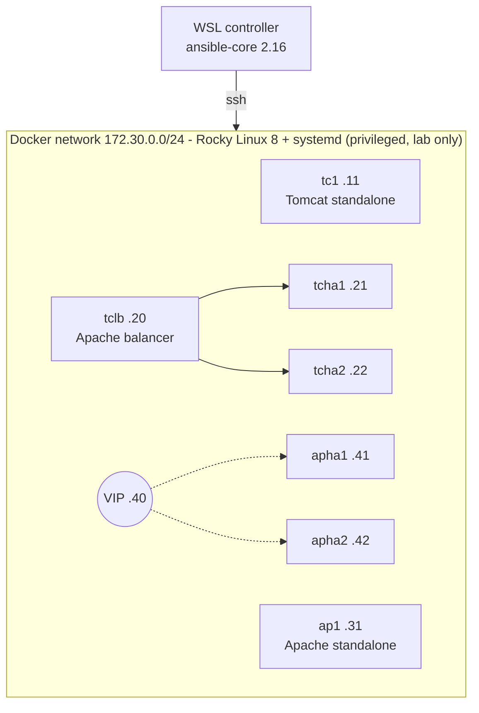

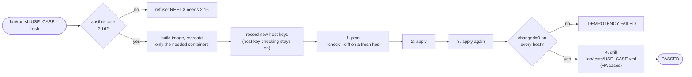

| Drill | Steps | Proves |
|---|---|---|
| `tests/tomcat_ha.yml` | cookie for node2 → stop Tomcat on node1 → 6 requests → start node1 | sticky sessions, failover, rejoin |
| `tests/apache_ha.yml` | standby the active node → VIP check → unstandby | VIP + httpd move together, VIP keeps answering, stickiness |

**Why ansible-core 2.16:** RHEL 8's system Python is 3.6. ansible-core 2.17+ cannot run modules
there (`dnf` needs that Python's bindings). AAP 2.5's supported execution environments ship 2.16,
so the lab matches what a customer's AAP would run.

---

## 10. Delivery: AAP and customer handover

### 10.1 Running in AAP

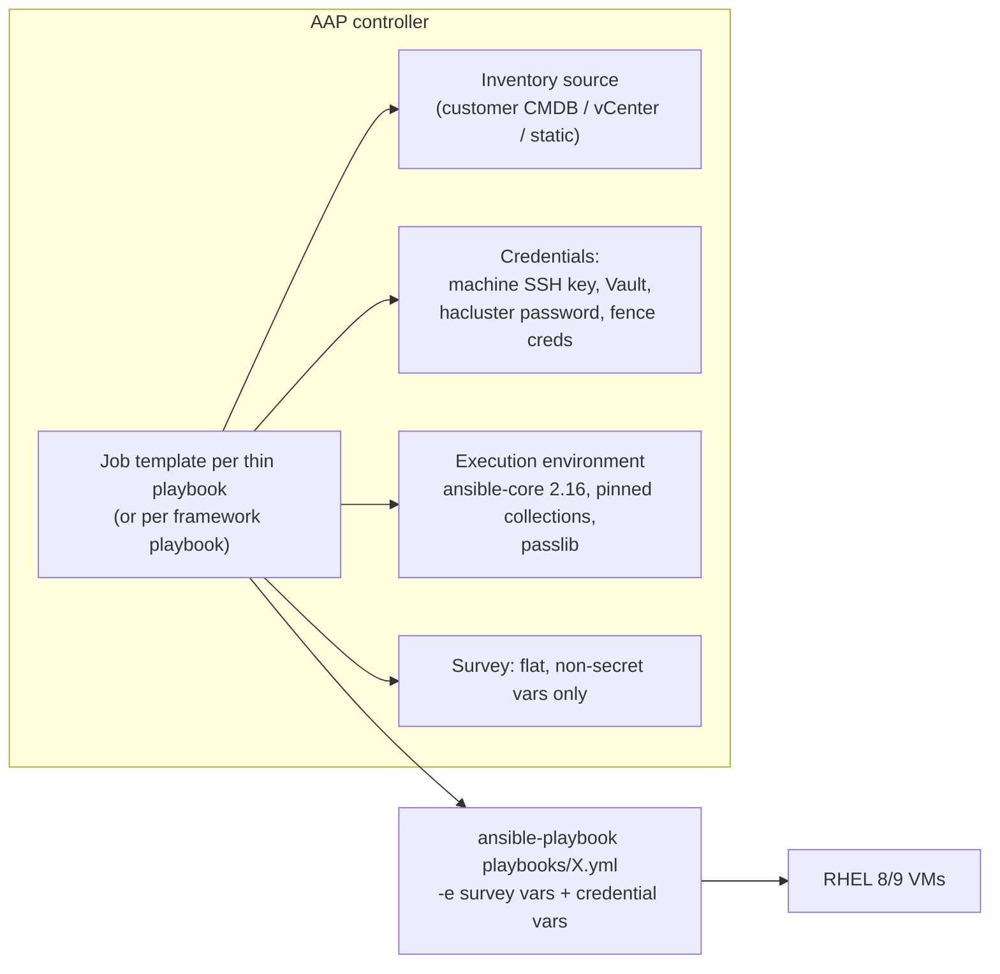

A typical customer workflow template: *their* VM provisioning job → the thin playbook job →
*their* CMDB / monitoring onboarding job.

### 10.2 Handover export

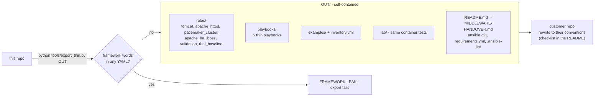

The receiving team can re-run `lab/run.sh all --fresh` inside the export to see the same results
before adapting names, repos and credentials.

---

## 11. Status

| Area | Status | Evidence |
|---|---|---|
| Contracts, dispatcher, profile, mock driver | **tested** | CI mock lifecycle incl. idempotency |
| Intake parser, adapters (GitHub, ServiceNow, ADO, custom) | **tested** | unit tests with injection / bad-value cases |
| `plan` workflow | **written** | never executed on GitHub |
| Apply workflow with approval gate | **planned** | - |
| `existing`, `azure`, `vmware` compute drivers | **written** | logic tests only; no real cloud / vCenter call |
| `terraform` driver, enterprise capabilities (dns, ipam, cmdb, backup, ...) | **planned** | - |
| `rhel_baseline`, `validation` | **written** | template / logic tests; not on a hardened RHEL host |
| `jboss` standalone | **written** | not run against Satellite / EAP |
| `tomcat` standalone | **tested** | Rocky 9 and Rocky 8 containers |
| `tomcat_ha`, `apache_standalone`, `apache_ha` | **tested** | Rocky 8 containers incl. failover drills, run from the export |
| Real RHEL, SELinux enforcing, firewalld, real fencing, VIP on a real network | **not yet** | confirm on the first customer hosts |

---

## 12. Extending the framework

| To add | Do this |
|---|---|
| A compute driver | `roles/cap_compute_<driver>/tasks/{apply,validate,revert}.yml`, inputs in `meta/argument_specs.yml`, set `cap_result` to `machine_result.v1`, bind it in a profile. |
| A new capability | add its result spec to `capability_dispatch/vars/main.yml` (and a JSON schema in `contracts/`), then drivers as above. |
| A customer | copy `profiles/example-lab/`, set `policy.allow_mock: false`, bind real drivers, fill the catalogue. Keep real profiles in a private repo. |
| A middleware use case | a role following section 7.2 (assert / install / configure / service / firewall / validate, argument specs, role-prefixed vars), a thin playbook following 7.1, lab vars + a container entry + an optional drill, then add both to `tools/export_thin.py`. |

## 13. Repository map

```text
contracts/            JSON Schemas: request.v1, machine_spec.v1, machine_result.v1
profiles/<name>/      profile.yml + catalogue.yml (the only customer-specific inputs)
tools/                intake adapters, issue parser, form generator, contract validator, export_thin.py
ansible/playbooks/    provision.yml, configure.yml, site.yml   (framework path)
ansible/playbooks/thin/  tomcat_*, apache_*, jboss_standalone  (thin path)
ansible/roles/        machine_resolve, capability_dispatch, cap_compute_*   (framework)
                      rhel_baseline, validation                             (OS)
                      tomcat, apache_httpd, jboss, pacemaker_cluster, apache_ha (middleware)
ansible/tests/        logic tests that need no host
lab/                  container lab: Dockerfile, compose.yml, inventory, vars, drills, run.sh
examples/             flat-variable examples for the thin playbooks
docs/                 this file, handover guides, learning notes
.github/workflows/    ci.yml (quality gates), plan.yml (request -> plan comment)
```
