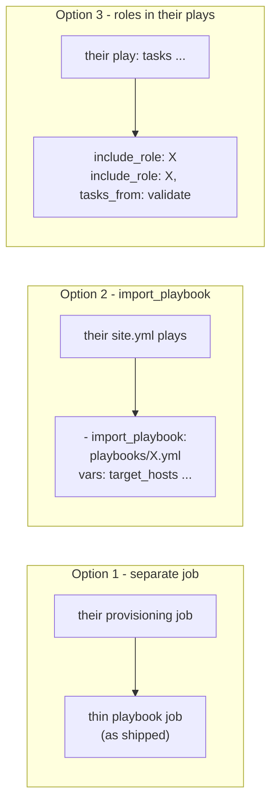

# Reusing a use case in another project

One page per use case: what it builds, **exactly which files to copy**, and how to plug it into a
project that already has its own `site.yml` (for example one that provisions RHEL VMs).

Paths are given as in the platform repo. In a `tools/export_thin.py` export they are one level
up: `ansible/roles/X` is `roles/X`, `ansible/playbooks/thin/X.yml` is `playbooks/X.yml`.

| Use case | Page | Roles it needs |
|---|---|---|
| Tomcat standalone | [tomcat_standalone.md](tomcat_standalone.md) | `tomcat` |
| Tomcat HA (2+ nodes + load balancer) | [tomcat_ha.md](tomcat_ha.md) | `tomcat`, `apache_httpd` |
| Apache httpd standalone | [apache_standalone.md](apache_standalone.md) | `apache_httpd` |
| Apache httpd HA (Pacemaker) | [apache_ha.md](apache_ha.md) | `apache_httpd`, `pacemaker_cluster`, `apache_ha` |

Every integration snippet on these pages was run against the container lab
(`lab/`, Rocky Linux 8, ansible-core 2.16) from a separate "existing project" with its own group
names and `group_vars`: preview (`--check`), apply, and the read-only validation passed with
`changed=0` on already-built hosts.

## What is optional everywhere

The thin playbooks can also apply `rhel_baseline` (`run_baseline: true`) and the OS `validation`
role (`run_os_validation: true`). Both default off/skip in a project that already has a RHEL
build. Copy them only if you turn them on:

| Optional role | Files | Extra collection |
|---|---|---|
| `rhel_baseline` | `ansible/roles/rhel_baseline/` (12 files) | `community.general` (LVM, filesystem, timezone) |
| `validation` | `ansible/roles/validation/` (3 files) | - |

The roles are loaded with `include_role`, so a role that is switched off does not need to exist.

## Three ways to integrate



| | Option 1 - separate AAP job | Option 2 - `import_playbook` | Option 3 - roles in their plays |
|---|---|---|---|
| Copy | playbook + roles | playbook + roles | roles only |
| Change to their code | none (AAP workflow template) | a few lines at the end of `site.yml` | tasks added to their plays |
| Input checks before any host is touched | yes | yes | no - the roles still assert their own inputs on each host |
| Best when | their pipeline is AAP workflows | one `site.yml` drives everything | they want the steps inside their own plays and naming |

**Recommendation:** Option 2 for the HA use cases (the playbooks hold per-node defaults and
cross-host wiring you would otherwise re-create), Option 2 or 3 for the standalone ones.

## Rules that apply to every option

1. **ansible-core 2.16 for RHEL 8 targets.** RHEL 8's system Python is 3.6; 2.17+ cannot manage
   it. AAP 2.5's supported execution environments ship 2.16.
2. **Order:** the VMs must exist, be reachable over SSH and be in the inventory (or added with
   `add_host`) before these plays run. Put them after the provisioning plays.
3. **`become: true` and `gather_facts: true`** on the plays that run the roles.
4. **Variables:** put product settings in `group_vars/<their group>.yml` (or the job template's
   extra vars). Secrets (hacluster password, fence credentials) come from AAP credentials or
   Vault, never from these files.
5. **Inputs checked on localhost (Option 2):** the first play of each thin playbook runs on
   `localhost`, which does not see `group_vars/<their group>.yml`. Values it checks (for example
   `apache_ha_vip_address`) must be in the `import_playbook` `vars:`, in `group_vars/all`, or in
   extra vars.
6. **Handlers (Option 3):** the roles flush handlers before starting their service, so any
   handler *their* play notified earlier also runs at that point.
7. **Names:** keep the role directory names (`tomcat`, `apache_httpd`, ...) - the playbooks and
   the role-prefixed variables use them. Rename only with a full search and replace.

## Testing before you integrate

Copy `lab/` as well (see each page) and run the use case in containers first:

```bash
ANSIBLE_BIN_DIR=~/.venvs/ansible216/bin lab/run.sh tomcat_standalone --fresh
```

or point your copy at one of your own test VMs: preview, apply, apply again (expect
`changed=0`), and check the validation tasks pass.
