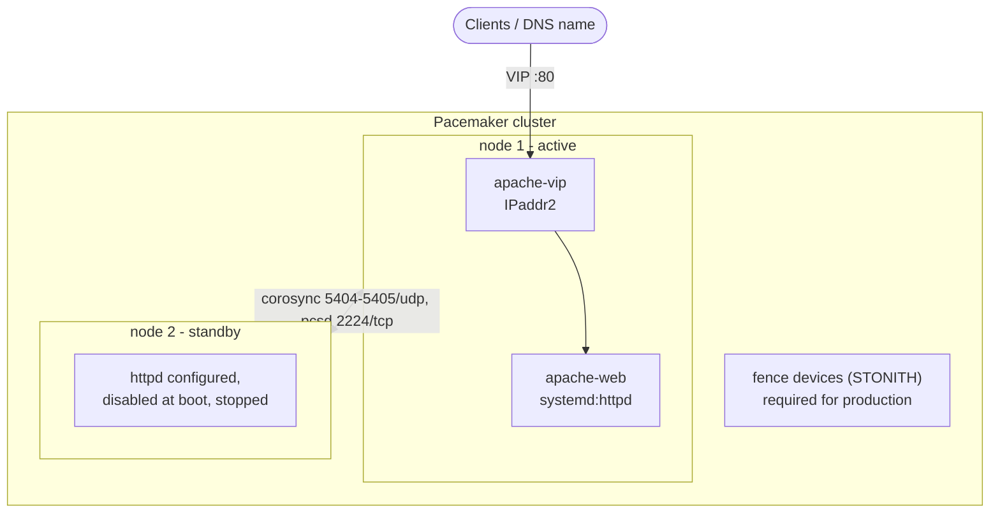

# Use case: Apache httpd HA (Pacemaker, active/passive)

Two RHEL 8/9 VMs in one subnet form a Pacemaker/Corosync cluster. httpd is installed and
configured on both, but only the cluster starts it: together with a floating IP (VIP) on one
node at a time, moving both on failure. Back to the [use-case index](README.md).



## Files to copy

**Required**

| Repo path | Copy to (your project) |
|---|---|
| `ansible/roles/apache_httpd/` - all 12 files (see [apache_standalone.md](apache_standalone.md#files-to-copy)) | `roles/apache_httpd/` |
| `ansible/roles/pacemaker_cluster/defaults/main.yml` | `roles/pacemaker_cluster/defaults/main.yml` |
| `ansible/roles/pacemaker_cluster/meta/argument_specs.yml` | `roles/pacemaker_cluster/meta/argument_specs.yml` |
| `ansible/roles/pacemaker_cluster/tasks/main.yml` | `roles/pacemaker_cluster/tasks/main.yml` |
| `ansible/roles/pacemaker_cluster/tasks/assert.yml` | `roles/pacemaker_cluster/tasks/assert.yml` |
| `ansible/roles/pacemaker_cluster/tasks/install.yml` | `roles/pacemaker_cluster/tasks/install.yml` |
| `ansible/roles/pacemaker_cluster/tasks/firewall.yml` | `roles/pacemaker_cluster/tasks/firewall.yml` |
| `ansible/roles/pacemaker_cluster/tasks/cluster.yml` | `roles/pacemaker_cluster/tasks/cluster.yml` |
| `ansible/roles/pacemaker_cluster/tasks/properties.yml` | `roles/pacemaker_cluster/tasks/properties.yml` |
| `ansible/roles/pacemaker_cluster/tasks/validate.yml` | `roles/pacemaker_cluster/tasks/validate.yml` |
| `ansible/roles/apache_ha/defaults/main.yml` | `roles/apache_ha/defaults/main.yml` |
| `ansible/roles/apache_ha/meta/argument_specs.yml` | `roles/apache_ha/meta/argument_specs.yml` |
| `ansible/roles/apache_ha/tasks/main.yml` | `roles/apache_ha/tasks/main.yml` |
| `ansible/roles/apache_ha/tasks/assert.yml` | `roles/apache_ha/tasks/assert.yml` |
| `ansible/roles/apache_ha/tasks/resources.yml` | `roles/apache_ha/tasks/resources.yml` |
| `ansible/roles/apache_ha/tasks/validate.yml` | `roles/apache_ha/tasks/validate.yml` |

**Options 1 and 2 also need the playbook**

| Repo path | Copy to |
|---|---|
| `ansible/playbooks/thin/apache_ha.yml` | `playbooks/apache_ha.yml` |

**Optional**

| Repo path | When |
|---|---|
| `examples/thin/apache_ha.vars.yml` | starting point incl. a fence device example |
| `ansible/roles/rhel_baseline/`, `ansible/roles/validation/` | only with `run_baseline` / `run_os_validation` |
| `lab/Dockerfile`, `lab/compose.yml`, `lab/inventory.yml`, `lab/run.sh`, `lab/vars/apache_ha.yml`, `lab/tests/apache_ha.yml` | container test incl. the failover drill |

**Collections:** `ansible.posix` (firewalld; `seboolean` when proxying).
**Controller / execution environment:** `passlib` (hashes the hacluster password).
**On the VMs:** the RHEL High Availability repository (`rhel-8-for-x86_64-highavailability-rpms`
or the RHEL 9 equivalent) enabled through Satellite / the activation key; both nodes in the same
subnet as the VIP.

## Inputs you normally set

| Variable | Required | Notes |
|---|---|---|
| `apache_ha_vip_address` | **yes** | reserved, unused IPv4 in the nodes' subnet; DNS points here |
| `apache_ha_vip_cidr_netmask` | | default `24` |
| `pacemaker_cluster_password` | **yes, secret** | hacluster password - AAP credential or Vault only |
| `pacemaker_cluster_fence_devices` | **yes for production** | list of `{name, agent, options}`, e.g. `fence_vmware_rest` (credentials from Vault) |
| `pacemaker_cluster_name` | | default `ha_cluster` |
| `pacemaker_cluster_enable_repos` | | dnf repo ids to enable for the cluster packages; usually `[]` on RHEL |
| `pacemaker_cluster_firewall_services` | | default `[high-availability]`; `[]` without firewalld |
| `apache_httpd_server_name`, `apache_httpd_firewall_ports` | | as in [apache_standalone.md](apache_standalone.md) |

Fencing is fail-closed: the run stops unless fence devices are listed, or **both**
`pacemaker_cluster_stonith_enabled: false` and `pacemaker_cluster_allow_no_fencing: true` are set
(lab only - never in production).

## Integrate into an existing `site.yml`

Assume your inventory has a group `web_cluster` with exactly the two cluster VMs.

`group_vars/web_cluster.yml`:
```yaml
---
apache_ha_vip_address: 10.0.0.50
apache_ha_vip_cidr_netmask: 24
apache_httpd_server_name: web.example.invalid
apache_httpd_firewall_ports: ["80/tcp"]
pacemaker_cluster_name: web_cluster
pacemaker_cluster_fence_devices:
  - name: fence_vcenter
    agent: fence_vmware_rest
    options:
      ip: vcenter.example.invalid
      username: "{{ vault_fence_user }}"
      password: "{{ vault_fence_password }}"
      ssl_insecure: "0"
      pcmk_host_map: "webha01:webha01-vm;webha02:webha02-vm"
```

`pacemaker_cluster_password`, `vault_fence_user` and `vault_fence_password` come from Vault or
AAP credentials (`-e @vault.yml` / credential injection).

### Option 2 - append the playbook (recommended)

The playbook's first play checks the VIP, the password and the fencing decision on `localhost`,
which does not read `group_vars/web_cluster.yml`. Give those values in the import `vars:` (or
`group_vars/all`, or extra vars):

```yaml
- name: Apache HA
  ansible.builtin.import_playbook: playbooks/apache_ha.yml
  vars:
    target_hosts: web_cluster
    run_os_validation: false
    apache_ha_vip_address: 10.0.0.50
```

and move `pacemaker_cluster_fence_devices` from `group_vars/web_cluster.yml` to the import
`vars:` or to an extra-vars file (`-e @apache_ha.vars.yml`), so the localhost check sees it.
The password is already an extra var from Vault / the AAP credential.

### Option 3 - add the roles to your own play

The play must target **exactly the cluster nodes** - the cluster is formed from the play's hosts.
Run it after your provisioning plays:

```yaml
- name: Apache HA
  hosts: web_cluster
  become: true
  gather_facts: true
  vars:
    apache_httpd_cluster_managed: true    # httpd configured on both nodes, started only by the cluster
  tasks:
    - name: Install and configure Apache httpd (left to the cluster)
      ansible.builtin.include_role:
        name: apache_httpd

    - name: Form the cluster
      ansible.builtin.include_role:
        name: pacemaker_cluster

    - name: Create the VIP and httpd resources
      ansible.builtin.include_role:
        name: apache_ha

    - name: Validate cluster, Apache and VIP (read-only)
      ansible.builtin.include_role:
        name: "{{ item.role }}"
        tasks_from: validate
      loop:
        - {role: pacemaker_cluster}
        - {role: apache_httpd}
        - {role: apache_ha}
      when: not ansible_check_mode
```

Order inside the play matters: `apache_httpd` -> `pacemaker_cluster` -> `apache_ha`.

## Test it

```bash
ansible-playbook site.yml -e @vault.yml --check --diff   # new VMs: says what it would install and create
ansible-playbook site.yml -e @vault.yml
ansible-playbook site.yml -e @vault.yml                  # web_cluster hosts must show changed=0
```

The validate steps check: quorum, both nodes members, fencing as decided (and every fence device
registered), the group on exactly one node, httpd running on exactly one node and disabled at
boot on both, `/health/` answering `OK` through the VIP from every node.

Failover by hand (on a node):
```bash
pcs node standby <active node>      # VIP + httpd move; curl http://<VIP>/health/ keeps answering OK
pcs node unstandby <active node>    # the group stays where it is (stickiness)
```
Test fencing itself in a maintenance window: `pcs stonith fence <node>`.

## Gotchas

- Fencing and the VIP on a real network (VMware/cloud anti-spoofing, switch ARP) were **not** testable in containers: verify both on the first real cluster.
- Do not let anything else (baseline, monitoring agent) enable or start `httpd` on these nodes - the cluster must be the only owner.
- Changing `pacemaker_cluster_password` later is supported (the hash is recomputed); changing node names or adding nodes to an existing cluster is not handled by the role.
- The cluster packages come from the High Availability repo, which needs its own RHEL subscription entitlement.
