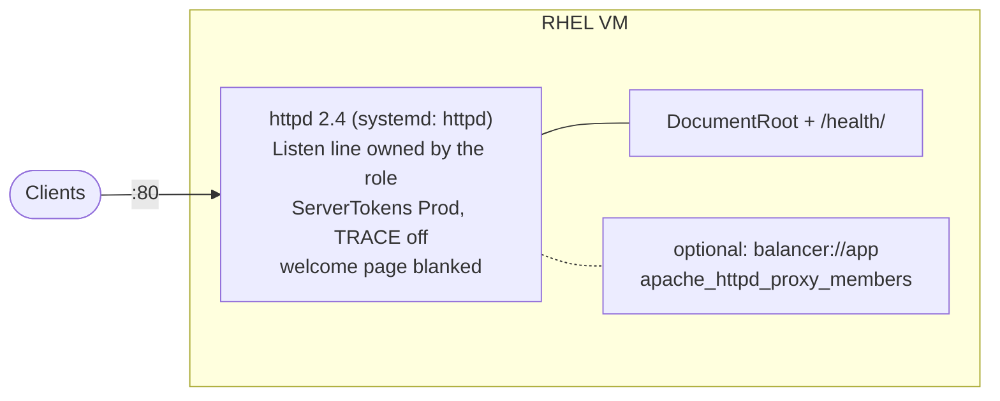

# Use case: Apache httpd standalone

Apache httpd 2.4 on one RHEL 8/9 VM: a hardened web server, optionally a reverse proxy / load
balancer. Back to the [use-case index](README.md).



## Files to copy

**Required**

| Repo path | Copy to (your project) |
|---|---|
| `ansible/roles/apache_httpd/defaults/main.yml` | `roles/apache_httpd/defaults/main.yml` |
| `ansible/roles/apache_httpd/handlers/main.yml` | `roles/apache_httpd/handlers/main.yml` |
| `ansible/roles/apache_httpd/meta/argument_specs.yml` | `roles/apache_httpd/meta/argument_specs.yml` |
| `ansible/roles/apache_httpd/tasks/main.yml` | `roles/apache_httpd/tasks/main.yml` |
| `ansible/roles/apache_httpd/tasks/assert.yml` | `roles/apache_httpd/tasks/assert.yml` |
| `ansible/roles/apache_httpd/tasks/install.yml` | `roles/apache_httpd/tasks/install.yml` |
| `ansible/roles/apache_httpd/tasks/configure.yml` | `roles/apache_httpd/tasks/configure.yml` |
| `ansible/roles/apache_httpd/tasks/service.yml` | `roles/apache_httpd/tasks/service.yml` |
| `ansible/roles/apache_httpd/tasks/firewall.yml` | `roles/apache_httpd/tasks/firewall.yml` |
| `ansible/roles/apache_httpd/tasks/validate.yml` | `roles/apache_httpd/tasks/validate.yml` |
| `ansible/roles/apache_httpd/templates/hardening.conf.j2` | `roles/apache_httpd/templates/hardening.conf.j2` |
| `ansible/roles/apache_httpd/templates/site.conf.j2` | `roles/apache_httpd/templates/site.conf.j2` |

In short: the whole `ansible/roles/apache_httpd/` folder.

**Options 1 and 2 also need the playbook**

| Repo path | Copy to |
|---|---|
| `ansible/playbooks/thin/apache_standalone.yml` | `playbooks/apache_standalone.yml` |

**Optional**

| Repo path | When |
|---|---|
| `examples/thin/apache_standalone.vars.yml` | starting point for your variables |
| `ansible/roles/rhel_baseline/`, `ansible/roles/validation/` | only with `run_baseline` / `run_os_validation` |
| `lab/Dockerfile`, `lab/compose.yml`, `lab/inventory.yml`, `lab/run.sh`, `lab/vars/apache_standalone.yml` | container test |

**Collections:** `ansible.posix` (firewalld; `seboolean` when proxying with SELinux enabled).

## Inputs you normally set

| Variable | Default | Notes |
|---|---|---|
| `apache_httpd_server_name` | host FQDN | |
| `apache_httpd_listen_port` | `80` | |
| `apache_httpd_listen_address` | `""` (all addresses) | or one IPv4 |
| `apache_httpd_document_root` | `/var/www/html` | your content goes here (the role only writes `/health/`) |
| `apache_httpd_firewall_ports` | `[]` | e.g. `["80/tcp"]` |
| `apache_httpd_proxy_members` | `[]` | list of `{route, url}` to act as a load balancer |

TLS is not in this role yet (planned): terminate TLS on the platform load balancer or add a
`ssl.conf` of your own.

## Integrate into an existing `site.yml`

Assume your inventory has a group `web`. `group_vars/web.yml`:

```yaml
---
apache_httpd_server_name: web.example.invalid
apache_httpd_firewall_ports: ["80/tcp"]
```

### Option 2 - append the playbook

```yaml
- name: Apache standalone
  ansible.builtin.import_playbook: playbooks/apache_standalone.yml
  vars:
    target_hosts: web
    run_os_validation: false
```

### Option 3 - add the role to your own play

```yaml
- name: Existing RHEL provisioning and baseline     # your play
  hosts: web
  become: true
  gather_facts: true
  tasks:
    # ... your existing tasks ...

    - name: Install and configure Apache httpd
      ansible.builtin.include_role:
        name: apache_httpd

    - name: Validate Apache httpd (read-only)
      ansible.builtin.include_role:
        name: apache_httpd
        tasks_from: validate
      when: not ansible_check_mode
```

## Test it

```bash
ansible-playbook site.yml --check --diff     # on a new VM the role says it would install httpd
ansible-playbook site.yml
ansible-playbook site.yml                    # web hosts must show changed=0
```

The validate step checks: `httpd -t`, service running and enabled, `/health/` answers `OK`, the
`Server` header is plain `Apache` (no version), TRACE returns 405, the port listens, workers do
not run as root, the welcome page is disabled.

## Gotchas

- The role **owns the `Listen` line** in `httpd.conf`. Do not add another `Listen` for the same port elsewhere (httpd will not start).
- Every change runs `httpd -t` before the reload: a broken config fails the run and the running server keeps its old config.
- If your baseline also manages `httpd.conf` or `conf.d/welcome.conf`, decide which one owns them.
