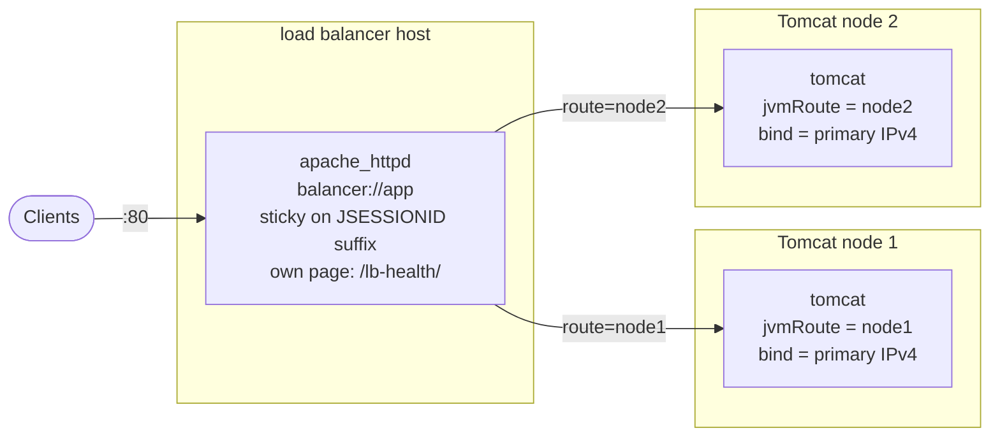

# Use case: Tomcat HA (2+ nodes behind a load balancer)

Two or more identical Tomcat nodes, each with a unique `jvmRoute`, behind an Apache httpd load
balancer with sticky sessions. A node that stops is skipped and retried. Sessions are **not**
replicated: users of a failed node log in again. Back to the [use-case index](README.md).



If the platform already has a load balancer (F5, NetScaler, cloud LB), skip the Apache part
(`run_load_balancer: false`, or leave the load balancer play out) and point the platform LB at
each node's `bind address:8080`, health check `GET /health/` -> `OK`, sticky on the
`JSESSIONID` route suffix.

## Files to copy

**Required**

| Repo path | Copy to (your project) |
|---|---|
| `ansible/roles/tomcat/` - all 13 files (see [tomcat_standalone.md](tomcat_standalone.md#files-to-copy)) | `roles/tomcat/` |
| `ansible/roles/apache_httpd/defaults/main.yml` | `roles/apache_httpd/defaults/main.yml` |
| `ansible/roles/apache_httpd/handlers/main.yml` | `roles/apache_httpd/handlers/main.yml` |
| `ansible/roles/apache_httpd/meta/argument_specs.yml` | `roles/apache_httpd/meta/argument_specs.yml` |
| `ansible/roles/apache_httpd/tasks/main.yml` | `roles/apache_httpd/tasks/main.yml` |
| `ansible/roles/apache_httpd/tasks/assert.yml` | `roles/apache_httpd/tasks/assert.yml` |
| `ansible/roles/apache_httpd/tasks/install.yml` | `roles/apache_httpd/tasks/install.yml` |
| `ansible/roles/apache_httpd/tasks/configure.yml` | `roles/apache_httpd/tasks/configure.yml` |
| `ansible/roles/apache_httpd/tasks/service.yml` | `roles/apache_httpd/tasks/service.yml` |
| `ansible/roles/apache_httpd/tasks/firewall.yml` | `roles/apache_httpd/tasks/firewall.yml` |
| `ansible/roles/apache_httpd/tasks/validate.yml` | `roles/apache_httpd/tasks/validate.yml` |
| `ansible/roles/apache_httpd/templates/hardening.conf.j2` | `roles/apache_httpd/templates/hardening.conf.j2` |
| `ansible/roles/apache_httpd/templates/site.conf.j2` | `roles/apache_httpd/templates/site.conf.j2` |

`apache_httpd` is not needed when the platform load balancer is used.

**Options 1 and 2 also need the playbook**

| Repo path | Copy to |
|---|---|
| `ansible/playbooks/thin/tomcat_ha.yml` | `playbooks/tomcat_ha.yml` |

**Optional**

| Repo path | When |
|---|---|
| `examples/thin/tomcat_ha.vars.yml` | starting point for your variables |
| `ansible/roles/rhel_baseline/`, `ansible/roles/validation/` | only with `run_baseline` / `run_os_validation` |
| `lab/Dockerfile`, `lab/compose.yml`, `lab/inventory.yml`, `lab/run.sh`, `lab/vars/tomcat_ha.yml`, `lab/tests/tomcat_ha.yml` | container test incl. the failover drill |

**Collections:** `ansible.posix` (firewalld, and `seboolean` for SELinux on the balancer).

## Inputs you normally set

| Variable | Where | Default | Notes |
|---|---|---|---|
| `tomcat_bind_address` | nodes | the node's primary IPv4 | the balancer must reach it |
| `tomcat_jvm_route` | nodes | inventory short name | unique per node |
| `tomcat_firewall_ports` | nodes | `[]` | `["8080/tcp"]` so the balancer can connect |
| `tomcat_archive_url` / `tomcat_archive_sha512` | nodes | Apache 10.1.60 | your artifact repo |
| `apache_httpd_server_name` | balancer | host FQDN | the public name |
| `apache_httpd_firewall_ports` | balancer | `[]` | e.g. `["80/tcp"]` |
| `apache_httpd_proxy_path` | balancer | `/` | path to balance, e.g. `/app/` |
| `apache_httpd_proxy_retry` | balancer | `30` | seconds before a failed node is retried |

## Integrate into an existing `site.yml`

Assume your inventory has `tc_nodes` (the Tomcat VMs) and `tc_lb` (the balancer VM).

`group_vars/tc_nodes.yml`:
```yaml
---
tomcat_firewall_ports: ["8080/tcp"]
tomcat_archive_url: https://artifacts.example.invalid/tomcat/apache-tomcat-10.1.60.tar.gz
tomcat_archive_sha512: "<sha512>"
```

`group_vars/tc_lb.yml`:
```yaml
---
apache_httpd_server_name: app.example.invalid
apache_httpd_firewall_ports: ["80/tcp"]
```

### Option 2 - append the playbook (recommended)

```yaml
- name: Tomcat HA
  ansible.builtin.import_playbook: playbooks/tomcat_ha.yml
  vars:
    target_hosts: tc_nodes
    lb_hosts: tc_lb
    run_os_validation: false
    # run_load_balancer: false   # when the platform load balancer is used
```

The playbook sets per-node defaults, checks `jvmRoute`s are unique, builds the balancer member
list from the nodes, and finally sends requests through the balancer and checks every node
answered.

### Option 3 - add the roles to your own plays

Three pieces: per-node defaults, the Tomcat role on the nodes, the balancer on the LB host.
The node play must run **before** the balancer play (the balancer reads the nodes' facts).

```yaml
- name: Tomcat HA nodes
  hosts: tc_nodes
  become: true
  gather_facts: true
  tasks:
    # ... your existing tasks for these hosts ...

    - name: Default the bind address to the node's primary IPv4
      ansible.builtin.set_fact:
        tomcat_bind_address: "{{ ansible_facts['default_ipv4']['address'] }}"
      when: tomcat_bind_address is not defined

    - name: Default the jvmRoute to the node's short name
      ansible.builtin.set_fact:
        tomcat_jvm_route: "{{ inventory_hostname_short | regex_replace('[^A-Za-z0-9_-]', '_') }}"
      when: tomcat_jvm_route is not defined

    - name: Install and configure Tomcat
      ansible.builtin.include_role:
        name: tomcat

    - name: Validate Tomcat (read-only)
      ansible.builtin.include_role:
        name: tomcat
        tasks_from: validate
      when: not ansible_check_mode

- name: Tomcat HA load balancer
  hosts: tc_lb
  become: true
  gather_facts: true
  vars:
    apache_httpd_health_context: lb-health   # Tomcat's /health/ is proxied, so the LB's own page moves
    apache_httpd_proxy_members: >-
      
      
      
      
      {{ members }}
  tasks:
    - name: Install and configure Apache httpd as the balancer
      ansible.builtin.include_role:
        name: apache_httpd

    - name: Validate Apache httpd (read-only)
      ansible.builtin.include_role:
        name: apache_httpd
        tasks_from: validate
      when: not ansible_check_mode
```

Option 3 leaves out the playbook's end-to-end check through the balancer; run
`curl http://<lb>/health/` a few times (expect `OK`) or use Option 2.

## Test it

```bash
ansible-playbook site.yml --check --diff
ansible-playbook site.yml
ansible-playbook site.yml        # tc_nodes and tc_lb must show changed=0
```

Failover by hand: stop Tomcat on one node (`systemctl stop tomcat`), request
`http://<lb>/health/` several times - every answer must be `OK`; start it again. In the
container lab the drill `lab/tests/tomcat_ha.yml` does this automatically, including a sticky
session check.

## Gotchas

- `tomcat_bind_address` must not be loopback behind a balancer; the playbook refuses it.
- With SELinux enforcing the balancer needs `httpd_can_network_connect`; the role sets it only when SELinux is enabled and members are configured.
- Health page names: the balancer's own page is `/lb-health/`, `/health/` is Tomcat's, through the balancer.
- No session replication: add Tomcat clustering (DeltaManager / external session store) separately if the application needs it.
