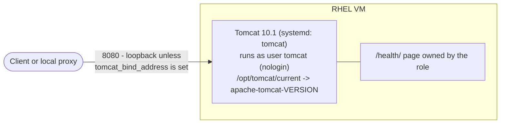

# Use case: Tomcat standalone

Apache Tomcat 10.1 on one RHEL 8/9 VM, from a checksum-pinned archive, as a hardened systemd
service. Back to the [use-case index](README.md).



## Files to copy

**Required**

| Repo path | Copy to (your project) |
|---|---|
| `ansible/roles/tomcat/defaults/main.yml` | `roles/tomcat/defaults/main.yml` |
| `ansible/roles/tomcat/handlers/main.yml` | `roles/tomcat/handlers/main.yml` |
| `ansible/roles/tomcat/meta/argument_specs.yml` | `roles/tomcat/meta/argument_specs.yml` |
| `ansible/roles/tomcat/tasks/main.yml` | `roles/tomcat/tasks/main.yml` |
| `ansible/roles/tomcat/tasks/assert.yml` | `roles/tomcat/tasks/assert.yml` |
| `ansible/roles/tomcat/tasks/install_archive.yml` | `roles/tomcat/tasks/install_archive.yml` |
| `ansible/roles/tomcat/tasks/install_rpm.yml` | `roles/tomcat/tasks/install_rpm.yml` (placeholder for the JWS/Satellite source) |
| `ansible/roles/tomcat/tasks/configure.yml` | `roles/tomcat/tasks/configure.yml` |
| `ansible/roles/tomcat/tasks/service.yml` | `roles/tomcat/tasks/service.yml` |
| `ansible/roles/tomcat/tasks/firewall.yml` | `roles/tomcat/tasks/firewall.yml` |
| `ansible/roles/tomcat/tasks/validate.yml` | `roles/tomcat/tasks/validate.yml` |
| `ansible/roles/tomcat/templates/server.xml.j2` | `roles/tomcat/templates/server.xml.j2` |
| `ansible/roles/tomcat/templates/tomcat.service.j2` | `roles/tomcat/templates/tomcat.service.j2` |

In short: the whole `ansible/roles/tomcat/` folder.

**Options 1 and 2 also need the playbook**

| Repo path | Copy to |
|---|---|
| `ansible/playbooks/thin/tomcat_standalone.yml` | `playbooks/tomcat_standalone.yml` |

**Optional**

| Repo path | When |
|---|---|
| `examples/thin/tomcat_standalone.vars.yml` | starting point for your variables |
| `ansible/roles/rhel_baseline/`, `ansible/roles/validation/` | only with `run_baseline: true` / `run_os_validation: true` |
| `lab/Dockerfile`, `lab/compose.yml`, `lab/inventory.yml`, `lab/run.sh`, `lab/vars/tomcat_standalone.yml` | to run the container test in your project |

**Collections:** `ansible.posix` (firewalld). Nothing else beyond `ansible.builtin`.

**On the VM:** sudo for the SSH user, the `java-17-openjdk-headless` package available from its
repos, and HTTPS access to `tomcat_archive_url` (point it at your artifact repository).

## Inputs you normally set

| Variable | Default | Notes |
|---|---|---|
| `tomcat_archive_url` | archive.apache.org 10.1.60 | must be `https://`; use your artifact repo |
| `tomcat_archive_sha512` | sha512 of 10.1.60 | must match the file; change together with the URL and `tomcat_version` |
| `tomcat_version` | `10.1.60` | |
| `tomcat_bind_address` | `""` (loopback only) | the VM's IPv4 to serve on the network |
| `tomcat_http_port` | `8080` | 1024-65535 (never runs as root) |
| `tomcat_firewall_ports` | `[]` | e.g. `["8080/tcp"]` when the bind address is set |
| `tomcat_java_opts` | `-Xms256m -Xmx512m` | |

Full list: `roles/tomcat/defaults/main.yml` and `meta/argument_specs.yml`.

## Integrate into an existing `site.yml`

Assume your `site.yml` already provisions RHEL VMs and your inventory has a group
`app_servers` for them. Put the settings in `group_vars/app_servers.yml`:

```yaml
---
tomcat_bind_address: "10.0.0.11"        # or "{{ ansible_facts['default_ipv4']['address'] }}"
tomcat_firewall_ports: ["8080/tcp"]
tomcat_archive_url: https://artifacts.example.invalid/tomcat/apache-tomcat-10.1.60.tar.gz
tomcat_archive_sha512: "<128-character sha512 of that file>"
```

### Option 2 - append the playbook

Copy the role and the playbook, then add at the **end** of `site.yml`:

```yaml
- name: Tomcat standalone
  ansible.builtin.import_playbook: playbooks/tomcat_standalone.yml
  vars:
    target_hosts: app_servers
    run_os_validation: false     # true only if you copied the validation role
```

### Option 3 - add the role to your own play

Copy only the role, then add two tasks to the play that already targets `app_servers`
(after your provisioning / baseline tasks):

```yaml
- name: Existing RHEL provisioning and baseline     # your play
  hosts: app_servers
  become: true
  gather_facts: true
  tasks:
    # ... your existing tasks ...

    - name: Install and configure Tomcat
      ansible.builtin.include_role:
        name: tomcat

    - name: Validate Tomcat (read-only)
      ansible.builtin.include_role:
        name: tomcat
        tasks_from: validate
      when: not ansible_check_mode
```

If your play uses `roles:` instead of `tasks:`, add `- role: tomcat` to that list and keep the
validate task under `tasks:` (roles run before tasks).

### Option 1 - separate AAP job

Job template on `playbooks/tomcat_standalone.yml`, inventory = yours, extra vars
`target_hosts: app_servers` plus the settings above; chain it after your provisioning job in a
workflow template.

## Test it

```bash
ansible-playbook site.yml --check --diff     # preview; on a new VM the role says what it would download
ansible-playbook site.yml                    # apply
ansible-playbook site.yml                    # again: the app_servers hosts must show changed=0
```

The validate step checks: service running, `/health/` answers `OK`, the expected version is
active, HTTP not exposed beyond loopback unless you asked, port 8005 closed, the service does not
run as root, default webapps removed.

## Gotchas

- `tomcat_install_source: rpm` (JBoss Web Server from Satellite) fails on purpose until it is implemented - use `archive`.
- A plan on a VM without Tomcat skips the configuration diff (nothing on disk yet) and prints what it would install.
- Upgrade = change `tomcat_version`, URL and sha512 together; the old version stays on disk, so rollback = the old values.
- SELinux enforcing and firewalld were not in the test containers: confirm on your first real host.
